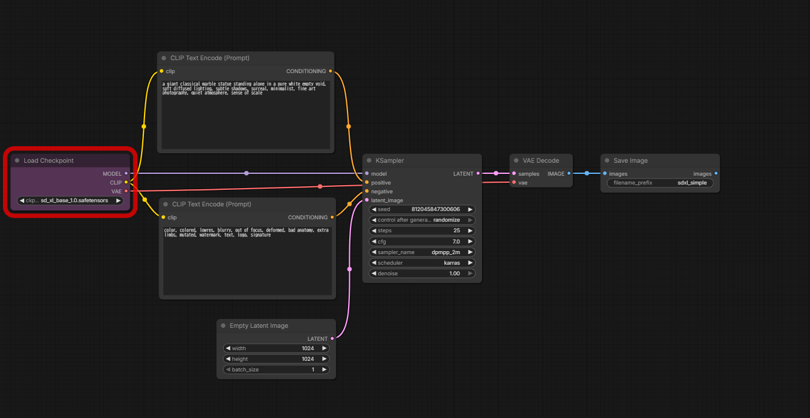

# Examples

These are examples of judgement, not rules. Use them as a reference for how the skill author would place things in a similar situation.
The author's words and reasons are kept, translated into English.

## Examples the skill author gave

- **Do not place anything directly below KSampler.** It gets hidden when the sampling preview appears. The VAE loader is sometimes placed above KSampler.
- **Place nodes whose size tends to change (Load Image and the like) low.**
- **When there are several inputs of the same type (three Load Image nodes, say), offset them in a staircase toward the lower right.** Stacking them vertically takes room; adding Reroutes would tidy it, but Reroutes should not multiply. This is the compromise between the two.
- **A thin node such as Conditioning Zero Out** (the rule is in readable-form.md). Keep such nodes near the trunk. This is not a rule but a judgement: "is this node worth a column of its own?" Feedback: "Opening a big gap for a node that does almost nothing, like Conditioning Zero Out, a node that just throws some value into negative when CFG is 1.0, is not beautiful. In this case, I'd allow placing it below the CLIP Text Encode (Prompt). That's what I would do."
- **A wire that crosses to another tier (Load Image → Get Image Size and the like): do not pack tight; leave a gap so the wire can be seen.** Tidy it with Reroute if needed.
- **Whether to color the image input of an I2V workflow.** Even the skill author's own workflows do it in some and not in others. The deciding factor is whether it gets noisy.

## The basic SDXL t2i (official template image_sdxl_simple), rebuilt by hand

- Feedback: "I'm not saying this is the right answer, but for this workflow I'd probably do it this way. The reason is a combination of two things: when there are many inputs, put the node that receives their outputs around the vertical middle of them; and make the main wire horizontal. Looking at the whole, things dropped down from the text encoders, so you couldn't see everything without scrolling. Of course, aiming for clarity is better than making it oddly compact, but this way no node is hidden and the whole becomes a bit smarter."
- Still valid in this layout: Load Checkpoint is at the left. KSampler → VAE Decode → Save Image run at one height. Empty Latent Image is below the negative CLIP Text Encode. The VAE wire runs straight from Load Checkpoint to VAE Decode and passes behind KSampler; this one wire is accepted.
- Do not copy this part of the image: here the MODEL wire is the level one (Load Checkpoint and KSampler share their top edge), and the two CLIP Text Encode nodes are moved off it, positive above and negative below. Follow the eyeline in readable-form.md instead: the positive conditioning wire runs level into KSampler, the negative side is below it, and the model loader is usually above the eyeline.

## From workflows rebuilt by hand (the main wire and vertical position)

- **Flux, HunyuanVideo (SamplerCustomAdvanced)**: the top row holds UNETLoader → (LoRA) → ModelSampling, and RandomNoise. The row below holds DualCLIPLoader → CLIP Text Encode → FluxGuidance, with BasicGuider to its right (the conditioning wire is level). SamplerCustomAdvanced sits at the vertical middle of its five input sources, stacked in one column at its left (RandomNoise, BasicGuider, KSamplerSelect, BasicScheduler, Empty Latent). VAELoader is above SamplerCustomAdvanced.
- **AnimateDiff**: the positive wire Load Checkpoint → LoraLoader → CLIP Text Encode(+) → Apply ControlNet → KSamplerAdvanced is at one height. The AnimateDiff nodes sit above as a block, and ADE_UseEvolvedSampling is at the vertical middle of the three nodes that connect to it (it is not aligned to the height of LoraLoader).
- **The later stage of SVD**: Image Only Checkpoint Loader and Video Linear CFG Guidance are on a row above the path. SVD_img2vid_Conditioning receives the image from the VAE Decode of the earlier stage and is level with the positive input of KSampler.

## Width

- The column of input sources to the left of SamplerCustomAdvanced is set to one width.
- KSampler, Load Diffusion Model and the like keep their initial width. Do not make them narrower.
- CLIP Text Encode (400) and Empty Latent Image (270): not matched (see readable-form.md).

## Nodes that change shape

- Two outputs: a staircase to the right (see readable-form.md). A near miss: save and Preview nodes were lifted upward to dodge wires, and because of that a rail stretched upward. The skill author asked for this to stop (the problem is less putting them above than the rail stretching upward).
- Save Image and Load Image are nodes for checking the output and the input. Do not pack them; give them a size at which the preview can be seen. Even in a small workflow such as a face swap, shrinking Load Image to pack things makes it harder to read than the original workflow.
- Do not fold Preview Image back below its source (it breaks the left-to-right flow).

## Replacements

- Upscale Image (ImageScale) → Resize Image/Mask (ResizeImageMaskNode, resize_type "scale dimensions"). The calculation is the same. The input names, the widget order and the default of crop differ, so copy every value. The same goes for ImageScaleToMaxDimension ("scale longer dimension") and ImageScaleToTotalPixels (when resolution_steps is 1, "scale total pixels").
- Apply ControlNet (DEPRECATED) → Apply ControlNet (ControlNetApplyAdvanced): see techniques.md.

## An image wire that crosses stages

- SDXL t2i → skin redraw: the image of the earlier stage goes into 4 places in the later stage (VAE Encode, Apply ControlNet, GroundingDinoSAMSegment, ImageCompositeMasked). The whole later stage is lowered below that wire, a Reroute rail runs above it, and the wire drops down to each target.

## Multi-stage workflows (rebuilt by hand)

- **Z-Image Hires.fix → 4x upscale → face Detailer → person Detailer**
  - The loaders (Unet → ModelSamplingAuraFlow, Load VAE, Load CLIP) are gathered at the top left, and five wires, MODEL, VAE, CLIP, positive and negative, run level across the top of the whole with Reroutes. Each stage drops what it needs down from the rail.
  - Eyeline: VAE Decode → Upscale Image (using Model) → FaceDetailer → DetailerForEach → Save Image are at nearly one height. Large nodes share their top edge.
  - The stages go left to right in processing order. The first stage, Hires.fix (KSampler → Upscale Latent By → KSampler), keeps the basic form.
  - The face detection loaders and the person mask chain (Load Checkpoint → CLIP Text Encode → SAM3 Detect → MaskFix+ → MaskToSEGS) are one tier below the eyeline, in processing order, just before where they are used.
  - No CFG value node is placed (the CFG 1.0 of a distilled model is not changed, so the value goes into each KSampler). Image Comparer is removed.
- **Wan2.2 t2i, two samplers (low noise and high noise), then upscale and run again**
  - Of the two model chains, the one that connects to the later sampler (low noise) is on top. The wires do not cross.
  - Only one Load CLIP and one Load VAE. A rail distributes them to both stages.
  - The eyeline runs from the VAE Decode of the first stage to Color Match, the final output.
  - The positive text (Concatenate Text) is above, the negative text (Text Multiline) below.
- **Make an image with Kontext, then a video with Wan2.2**
  - The Kontext stage and the Wan stage go left to right. The image from the Kontext VAE Decode crosses level to the Wan stage (WanImageToVideo, CLIP Vision Encode, Get Image Size).
  - The size comes from FluxKontextImageScale → Get Image Size → Empty SD3 Latent Image. Values typed in by hand are not distributed.
- **AnimateDiff with a start image and an end image**
  - The main wire: CLIP Text Encode(+) → Apply ControlNet (start) → Apply ControlNet (end) → AnimateDiffSampler. Load Checkpoint is at about the same height as the sampler, and the MODEL and VAE wires pass above the nodes on the path. The nodes on the path are below those wires.
  - The two keyframe chains (LatentKeyframeTiming → TimestepKeyframe → ACN ControlNet Loader) are above the path, one row each. The one that connects to the later Apply ControlNet is on top.
  - The two Load Image nodes form a staircase at the very bottom. The size is set only in the first Resize Image/Mask (scale dimensions); the second uses match size, and Empty Latent takes it from Get Image Size. The value nodes disappear and there are fewer wires.
  - Do not pack. Use the screen widely and show the wires.

## Replacements (that can be built in core)

- ImageResizeKJ (fits the longer side and center-crops to a multiple of 8) → two Resize Image/Mask: see techniques.md.
- A row of text replacements (StringReplace ×3 turning "image", "photo" and "picture" into "video") → one RegexReplace: see techniques.md.

## From workflows rebuilt by hand (input order, where loaders go, Reroute)

- **Anima drawn from a pose**: the pose chain (Load Image → AnimaPoseControl → Resize → VAE Encode) is laid out in one row on the bottom row and goes up to AnimaControlApply with a single wire. Load VAE is below Resize and connects directly to VAE Encode and VAE Decode. Get Image Size and Empty Latent are on the bottom row too. Zero Reroutes.
- **Anima with two reference images**: the image wire Load Image → AnimaRefEncode is level. Each Load Image and its encode form a pair side by side, and the two pairs are stacked vertically.
- **Head swap with Krea2**: Load VAE is to the left of the two VAE Encode nodes and connects directly to VAE Encode and VAE Decode. Each Load Image and its Resize form a pair side by side; the two pairs are stacked vertically. Get Image Size and Empty Latent are on the bottom row. Feedback: "Remove reroutes that mean nothing at all."
- **MiniMax reference to video**: SamplerCustomAdvanced + BasicGuider + KSamplerSelect + BasicScheduler are exactly equivalent to KSampler, so they were replaced with KSampler. Feedback: "This is too influenced by the wiring of the original workflow. It can be made cleaner."
- **Qwen-Image (hand-set sigmas), Flux (TeaCache), Flux Krea (redraw at 2x)**: to the left of SamplerCustomAdvanced, one column in input order (RandomNoise, BasicGuider, KSamplerSelect, the sigma node, Empty Latent). BasicScheduler → SplitSigmas goes in this column, not on the model row. Load VAE is above SamplerCustomAdvanced (to the upper left of VAE Decode). The width and height values are below. The VAE is carried sideways at its own height below (do not force the rail across the top at any cost). Feedback: "You have to think of the model-loading line and the role of making sigmas as separate. It's not that everything should be aligned just because it's connected. The usual shape is what connects to the sampler; that is what makes the whole workflow readable." For this workflow, groups are used too (to guide the eye).
- **Relighting with IC-Light**: in the foreground chain, Load Image and Resize are below, and from Remove Background on it runs sideways on the row above. The foreground chain and the IC-Light model and Apply share one color. The only Note is the model Note. Feedback: "Don't write things that are obvious at a glance, like background removal."
- **InstantID portrait (eye redraw → Hires.fix → eye redraw)**: the groups of the three stages share their top edge and height. There are three Load Image nodes (the face photo, the kps image, the pose image), and it is unclear which gets what, so that is exactly where a Note belongs. In the second eye redraw, positive and negative were wired the wrong way round; that was the workflow author's mistake, so fix it. Ending the middle with Save Image and the end with Preview Image was also wrong (save the final one).

## Stacking layers

- **Cutting out photos, stacking them and redrawing by depth (Create Layered Image and Add Layer)**: only the layer part runs bottom to top, the opposite of usual. The Add Layer for the background (forest) is at the bottom, the person above it, the Add Layer for the wolf at the top, and layers is wired from bottom to top. Feedback: "It's not great for processing order. But a layer naturally has the background at the bottom with things stacked on top. That should be shown on the nodes too, and doing so makes it intuitive to grasp." This applies only to layers. LoRA chains and Conditioning (Combine) stay in processing order. The same shape may sometimes be used when stacking with Image Composite Masked, but that is not ordinary processing.
- In the same workflow, the ControlNet set (Loader, Depth Anything, Preview Image, Apply ControlNet) shares one color. Two Notes: the model Note, and one saying the stacking positions can be fixed in the editor.

## Choosing a replacement

- **Compositor3 (a custom node that stacks images by dragging them on screen)**: it can be built from Image Composite Masked plus scaling and flipping nodes, but do not do that. Position and size would be typed in as numbers instead of dragged; the result is not the same, and it is not easier to use. Feedback: "If it can be built but isn't easy to use, there's no point." The hand rebuild used core Create Layered Image and Add Layer (positions can be fixed in the editor). However, these are experimental nodes. Feedback: "You can use them, but they're Nodes 2.0 only. And the UI is damn hard to use."

## Undecided

When a situation falls here, do not decide by your own rule; report what you did and what you were unsure about.

- **Parts-shelf workflows.** A workflow where many groups are switched on and off with bypass and assembled for each use does not fit in one workflow. Undecided; one direction: split it by function. Processing applied to the finished image (Detailer, Upscale, effects and so on) is post-processing: introduce in conversation what is there and ask whether the user wants any of it. If not, build only the main Text to Image. Decided, however: do not delete disabled functions, and if they can be split out, prepare them separately ("Functions going missing is no respect for the original workflow"). Among the generation parts, the ones worth a workflow of their own are those that change what can be done (Text to Image, Regional Prompting, ControlNet LLLite, Image to Image). A part that "might make things a little better", such as CFGZeroStar, is no reason for a separate setup.
- **A switch with only one input.** Removing it breaks equivalence. Keeping it means carrying many values, which gets messy. Undecided. (Decided: saving with metadata [Image Saver + Civitai Hash Fetcher and so on] is kept as a feature of the workflow author.)
- **Workflows that are too complex.** How to handle workflows with many nested subgraphs that expand to hundreds of nodes (chains of regular expressions that build text, and so on).
- **Conditional branches written in regular expressions.** Dozens of regular expressions in a row, branching on tags in the text. They cannot be changed. Leaving them as a subgraph may be easier to read.
- **What to hand over when splitting.** If what the author's wireless nodes (Image Sender and so on) were sending is turned directly into Save Image → Load Image, the later workflow may run the same processing (OpenPose and so on) a second time.
- **Level wires or shared top edges.** In the hand-placed examples, level wires win almost everywhere. The only pair with shared top edges was AnimateDiff's Latent Keyframe Timing → Timestep Keyframe. Undecided: how to tell when to take the top edge.
- **Put a node that gathers inputs at the middle of its sources, or share the top edge with its neighbor.** Where Detailer's Simple Detector (three inputs) and SEGS Filter sit side by side, the feedback was that their top edges were not aligned.
- **Routing a single wire around when even the output's height hits a node.** Whether to escape above or below.
- **Whether to simplify a size calculation the author built.** In a two-stage LTX 2.3 workflow, the author passed an empty 64×64 latent through the upscale model to measure the ratio (1.5 or 2), then rounded the finished size down to a multiple of 96 or 64 to get the Stage 1 size (6 nodes). Swapping the upscale model between x1.5 and x2 keeps the size right automatically. The LTX 2.5 workflow on the skill author's site gets the Stage 1 size from Resolution Selector (multiple 64) → Math "a / 2" (3 nodes, a single x2 upscale model). Feedback: "It should be possible to write this far more beautifully." "It won't be equivalent anymore, but, well, think about it a bit."

## Judgement examples (vertical position, columns)

- The model row above the eyeline, the Load Image tier, and VAE Decode with VAE Decode Audio in one column: see readable-form.md.
- What connects straight into the sampler (in Krea 2: Load LoRA, Empty Latent Image, and the two CLIP Text Encode) goes in one column, right-aligned. When CLIP Text Encode shifted one column left by the width of Empty Latent, the feedback was: "They should be in the same column, but there's a gap."
- Krea 2: the model row (UNET → LoRA → LoRA) is on top, and Load VAE is bottom-aligned with that row (the version judged good).
- A loader and the model nodes that follow it. Feedback: "In this workflow, model sampling auraflow should be aligned to the top of the model loader" (loader top at y -444, ModelSamplingAuraFlow top at y -106). "Unet Loader (GGUF) and ModelSamplingAuraFlow should be top-aligned so the line is horizontal." As a preference: "I also feel like top-aligning load checkpoint with the load lora and freeu part" (the agent had moved Load Checkpoint one tier down so the CLIP wire would not pass behind the LoRA).
- Do not widen the space to a neighbor connected by a wire without a reason. In a Kontext + LoRA workflow, 150px was left between Load LoRA and KSampler (gap 150 in the plan). Feedback: "This is scattered. The space between load lora and Ksampler is too big."
- The Load Image that makes the depth map can go below Load Depth Anything 3. Putting it to the left widens things by one column. Feedback: "Why on the left??"
- There is no point in bottom-aligning Load VAE with Load Image (height 424). Feedback: "load vae can be higher."
- Input sources of nodes with many inputs (WanAnimateToVideo, WanSoundImageToVideo):
  - Aligning by the processing flow is sometimes cleaner than aligning by the order of the input slots. The chain that cuts the face out of the DWPose output was placed above DWPose, to match the slot order (face_video above pose_video). Feedback: "It looks far cleaner below dwpose."
  - Do not put a Preview Image that does nothing into a right-aligned column. Shift the whole to align on the right edge of the node that does the processing (Image Composite Masked). Points Editor can be right-aligned with Load Checkpoint ("the whole becomes smarter").
  - Input loaders, Load Image and Load Audio are pulled close to the node that receives them, even at the cost of some wire overlap. WanSoundImageToVideo has 9 input slots in a row, and 700px was left between it and the prompt column. Feedback: "It should be possible to bring it closer. You can move it nearer to wansoundimagetovideo."
- Sizes (examples for "build a size from what it is for" in SKILL.md):
  - Qwen-Image-Layered: to split an input image into layers, the size of the empty latent was copied as the original 640×640. Feedback: "If it's splitting into layers, don't you have to get image size and connect it?" The shape on the skill author's site is Load Image → Scale Image to Total Pixels (0.5 MP) → Get Image Size → empty latent, and the shrunk image also goes into VAE Encode.
  - Wan 2.2 S2V: the width and height of the author's ImageResize+ (fit into an 832×480 frame) were copied with formulas that give the same values. Feedback: "Wouldn't it be better to resize the image to 0.4 MP (of course the resolution has to be rounded to the required multiple) and take width / height from it with get image size? The calculation is way too nonsensical." "As a ref image too, resizing before feeding it in makes it lighter."
  - Wan 2.2 Animate: the same size and length were taken from two separate places with two Get Image Size nodes. Feedback: "Aren't you doing get image size for the same size and length from two places?"
- Putting things that are different functions, with different outputs, in one group is wrong. Example: in a two-stage LTX 2.3 workflow, the decode of the Stage 1 result and the decode after upscaling were put in one group, "Decode". Feedback: "Having two of them is fine, as in the original workflow, but then I want the groups split."

## Judgement examples (one long wire in a single-stage workflow)

- In a single-stage workflow where the loader's VAE goes into both VAE Encode and VAE Decode, the hand layouts do not use a rail; they connect to both directly (0 Reroutes).
  - Text to Image with a pose reference image: the image chain (Load Image → … → VAE Encode, Get Image Size → Empty Latent Image) is on the bottom tier, and Load VAE is next to that tier's VAE Encode. The wire to VAE Decode runs diagonally between the nodes.
  - Relighting Text to Image: the wire from Load Checkpoint's VAE to VAE Decode runs diagonally and passes behind Load Diffusion Model on the way. This one wire is accepted.
- No rail for a single wire: see readable-form.md.

## Judgement examples (a large input that breaks the core)

- A workflow with a node that takes 9 reference image slots and 9 one-to-one Switch nodes. Laid out in input order, the Switch nodes piled up vertically in the same column as Load CLIP, Load VAE and the resolution picker, and the shape of the core broke. Feedback: they don't need to be in the same column. Build them a little away and bring the result in. Preprocessing far from the core is not part of the core.
- Text to Image that composites a background and then applies a depth ControlNet: the hand layout puts Load Image, background removal and the layer stacking to the left of Load Checkpoint (up to 1280px), and only the result is drawn into the core.
- The number of inputs changes with autogrow, so it cannot be fixed neatly. Judge by how the shape breaks.

## Judgement examples (the tier of an image chain)

- When an image chain that starts at Load Image also connects to Get Image Size → Empty Latent Image, the hand layouts put the chain on the bottom tier, in one row with Get Image Size and Empty Latent Image. To the other targets (ControlNet-type nodes on the model row, background removal and so on), wires go up from that tier.

## Judgement examples (unconnected parts, disabled branches, alternative branches)

- Resolution samples the author prepared (26 Empty Latent Image nodes connected to nothing; to use one you rewire it by hand): the nodes were removed and the values kept as a table in the Note on Empty Latent Image. Feedback: a table in the Note is fine.
- A finished stage not connected to the output (the Chroma and SDXL stages of a model comparison workflow, stopping at VAE Decode, with the author's Note saying "add Stitch to put it in the comparison row"): left unconnected, and how to connect it was written in a Note. Feedback: that's fine.
- A bypassed branch whose input sources are all empty, so it is unclear what it was meant to connect to (a group named "局部重绘", whose inputs are Get nodes with empty names): it does not work as a workflow, so remove it as debris and mention it in the report. Feedback: remove it.
- A switch between Tiled VAE Decode and plain VAE Decode (Boolean → Switch): it is a difference of method, with or without a speed-up, so keep one, the plain VAE Decode the author had enabled. Feedback: one.

## Judgement examples (the eyeline is set from the sampler)

- SeedVR2 image upscale (Load Image → Resize → Pre-Process SeedVR2 Input → VAE Encode → KSampler, Load Diffusion Model → Apply SeedVR2 Conditioning → KSampler): the hand layout puts KSampler at the height where the positive and negative of Apply SeedVR2 Conditioning enter it level, Load Diffusion Model above it, and the input image chain (Load Image through VAE Encode) one row below. Load VAE is below VAE Encode. Only the one wire carrying the original image to Post-Process became a rail running below. A near miss: the input image latent made level, with the model loader below the eyeline. Feedback: "The basic fundamentals aren't there."
- Wan 2.2 I2V: WanImageToVideo is top-aligned with CLIP Text Encode, and the trunk (WanImageToVideo → sampler → … → CreateVideo) continues right on that row. A near miss: the trunk placed below CLIP Text Encode. Feedback: "The eyeline is way too low."
- Load Checkpoint placed 400px above KSampler. Feedback: "too high" (steerable motion). Undecided: how far is acceptable.

## Judgement examples (samplers that split one continuous setting)

- 30 steps were split into three KSamplerAdvanced (0–10, 10–20, 20–end), with a different seed at each stage (add_noise disable for the 2nd and 3rd). The only difference from splitting is how the noise comes out at each step of an ancestral sampler; it does the same thing as 30 steps in one KSampler. Feedback: there is no point at all in splitting. Splitting is actually worse. It is misleading. Merge into one and write the difference in the report.

## Judgement examples (names)

- Do not use the author's group name as is; give it a name that fits what it contains. The author called "enlarge with an upscale model, then redraw at denoise 0.2" Upscale. Feedback: "This is less an upscale than an irregular hires.fix, or an enhance. It's a bit different from upscaling."

## Judgement examples (exceptions to backward wires)

- The rule is in readable-form.md. An example of the group exception: when an upscale or interpolation group is placed one tier below the trunk, the wire from the trunk's VAE Decode to the first node of the lower tier may run back down to the left. Undecided: where the line is drawn.

## Note examples (rewrites judged good)

In each, the before only set down facts. The after says the point in the heading (for a warning, the caution), and keeps what is below it short.

- The finishing upscaler has a value that makes the image smaller (caution)
  - Before: "The image going into SeedVR2 is 1200×1600 (960×1280 at 1.25x), but resolution is 896, so the short side is shrunk to 896."
  - After: "### With the current value, the image gets smaller at the finish" "resolution is not the upscale ratio but 'how many px the short side of the result should be'." "The short side of the image arriving here is 1200px, so 896 shrinks it. To enlarge it, set it above 1200."
- A cfg-distilled model with cfg at 1.1 (caution)
  - Before: "The negative text works well on the Base version. On the Distill version it works weakly, so it can be left empty (the author's explanation)"
  - After: "### With cfg at 1.1, most of the Distill version's speed is lost" "The Distill version is a model built to draw at cfg 1.0 without computing negative." "Raising cfg above 1.0 makes negative computed too, and the time per step nearly doubles."
  - The author's explanation (works weakly) had the wrong reason, so it was not used.
- Not written: sentences reading the nodes aloud from left to right, explanations of why things were wired this way, explanations of a graph that is only there to look at, and things everyone who uses ComfyUI knows (negative has no effect at cfg 1, and so on).
